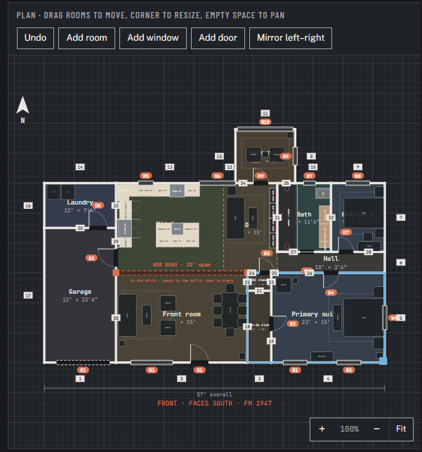
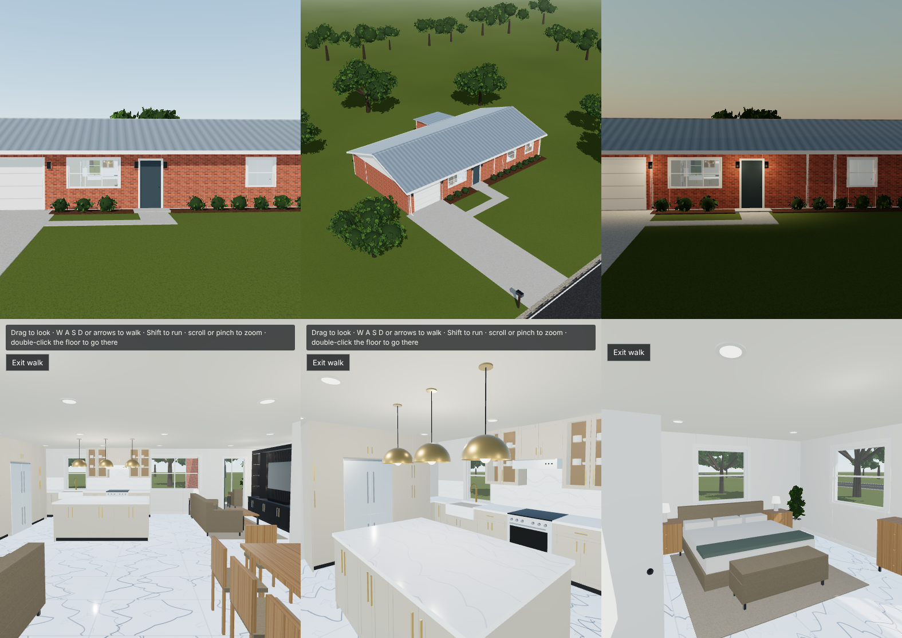

# 948 FM 1947 — Remodel Model

Interactive 3D remodel model of a 1963 brick ranch (1,354 sq ft) in Hillsboro, TX.

## Live shared model
**https://claude.ai/artifact/8MYaLFjXaDRcwwWMhuVYNT** — the working copy everyone edits together.
Only people the owner shares it with (Share menu → Contributor or Editor) can open or change it.
Edits there sync live for everyone; this repo is the backup of the code and exports.

- **index.html** — the complete app in one file (three.js r128 inlined, works offline and on GitHub Pages)
- **src-artifact.html** — the same app loading three.js from CDNs (source of truth)
- **build.py** — rebuilds `index.html` from the source (`npm i three@0.128.0` first)
- **docs/** — original DXF / OBJ / layout JSON exports and preview renders

## Floor plan (Remodel 1)

Garage 12′ × 22′6″ · Laundry 12′ × 7′6″ · Front room 22′ × 15′ · Kitchen · Den 9′ × 15′ · Bath 9′ × 11′6″ ·
Bedroom 3 · Hall 18′ × 3′6″ · Primary suite 23′ × 15′ with walk-in closet · Back room.
Walls 22/23/31 removed — **ADD BEAM, 22′ span, in the attic, posts in the walls down to piers.** House faces south to FM 1947; 57′ overall.

## Personal versions
The live model has a **Working on** menu at the top: the **Main house** everyone shares, plus a personal version for each person
(e.g. *Kandyce Blocker*, link ends in `#kandyce-blocker`). Edits in a personal version never touch the main house until someone
uses **Copy finishes to main house** or **Copy whole house to main**.

## Features
Editable floor plan · first-person walkthrough · street, aerial, bird's-eye and 360° tours ·
time of day · design studio with a material ID per surface (presets, colors, texture URL or upload) ·
saved designs · optional furniture · GLB export (offline file).

